<div class="cover">

  <!-- Motif tegangan tiga fasa (faint, di belakang) -->
  <div class="wave-bg">
    <svg viewBox="0 0 600 220" preserveAspectRatio="none" xmlns="http://www.w3.org/2000/svg">
      <path class="ph r" d="M0 110 C 50 20, 100 20, 150 110 S 250 200, 300 110 S 400 20, 450 110 S 550 200, 600 110 S 700 20, 750 110 S 850 200, 900 110" />
      <path class="ph s" d="M0 110 C 50 20, 100 20, 150 110 S 250 200, 300 110 S 400 20, 450 110 S 550 200, 600 110 S 700 20, 750 110 S 850 200, 900 110" />
      <path class="ph t" d="M0 110 C 50 20, 100 20, 150 110 S 250 200, 300 110 S 400 20, 450 110 S 550 200, 600 110 S 700 20, 750 110 S 850 200, 900 110" />
    </svg>
  </div>

  <header class="hdr">
    <div class="hdr-l">
      
      <div>
        <div class="hdr-uni">Universitas Mercu Buana</div>
        <div class="hdr-dept">Program Studi Teknik Mesin</div>
      </div>
    </div>
    <div class="hdr-tag">Teknik Tenaga Listrik</div>
  </header>

  <main class="ctr">
    <div class="badge">⚡ &nbsp; Persiapan Ujian Tengah Semester · Modul 1–4 &amp; 6</div>
    <div class="ttl1">Materi Penting UTS</div>
    <div class="ttl2">Dari pembangkit sampai saluran transmisi — konsep, rumus, dan jebakannya</div>
    <div class="fml">
      <span class="eq" v-html="eqHtml"></span>
      <span class="flow"><i></i><i></i><i></i></span>
      <span class="out ok">🏭&nbsp;Pembangkit</span>
      <span class="out-sep">→</span>
      <span class="out mid">🗼&nbsp;Transmisi</span>
      <span class="out-sep">→</span>
      <span class="out bad">🏠&nbsp;Beban</span>
    </div>
    <div class="sep"></div>
    <div class="au">
      <span class="au-name">Dedik Romahadi, S.T., M.Sc.</span>
      <span class="au-sem">Semester Gasal 2026/2027</span>
    </div>
  </main>

  <footer class="ftr">
    <span>Mata Kuliah Teknik Tenaga Listrik</span>
    <span class="dot">•</span>
    <span>S1 Teknik Mesin</span>
    <span class="dot">•</span>
    <span>Universitas Mercu Buana</span>
    <button class="cam-btn" :class="{ on: camOn }" @click.stop="toggleCam" :title="camOn ? 'Matikan kamera' : 'Nyalakan kamera'"><span class="cam-ico">📷</span></button>
    <span class="yr">{{ nowStr }}</span>
  </footer>
</div>

<script setup>
import { ref, onMounted, onBeforeUnmount } from 'vue'
import katex from 'katex'
import { camOn, toggleCam } from './useCamera'
const eqHtml = katex.renderToString('P = \\sqrt{3}\\,V_L I_L \\cos\\varphi', { throwOnError: false })
const nowStr = ref('')
let timer
function tick() {
  const d = new Date()
  const day = d.toLocaleDateString('id-ID', { weekday: 'long', day: 'numeric', month: 'long', year: 'numeric', timeZone: 'Asia/Jakarta' })
  const time = d.toLocaleTimeString('id-ID', { hour: '2-digit', minute: '2-digit', second: '2-digit', timeZone: 'Asia/Jakarta' })
  nowStr.value = `${day} · ${time} WIB`
}
onMounted(() => { tick(); timer = setInterval(tick, 1000) })
onBeforeUnmount(() => clearInterval(timer))
</script>

<style scoped>
.cover { background: #080e1a; position: absolute; inset: 0; display: flex; flex-direction: column; overflow: hidden; color: #f1f5f9; }
.wave-bg { position: absolute; top: 50%; left: 0; right: 0; transform: translateY(-42%); height: 260px; opacity: 0.22; pointer-events: none; }
.wave-bg svg { width: 100%; height: 100%; overflow: visible; }
.ph { fill: none; stroke-width: 3; stroke-linecap: round; animation: ph-run 6s linear infinite; }
.ph.r { stroke: #fb7185; }
.ph.s { stroke: #fbbf24; animation-delay: -2s; }
.ph.t { stroke: #38bdf8; animation-delay: -4s; }
/* Satu periode = 300 satuan; tiga fasa digeser sepertiga periode (120°). */
@keyframes ph-run { from { transform: translateX(0); } to { transform: translateX(-300px); } }
.hdr {
  display: flex; align-items: center; justify-content: space-between;
  padding: 5px 32px; position: relative; z-index: 10;
  background:
    radial-gradient(120% 180% at 50% -60%, rgba(124,77,255,0.14), transparent 60%),
    linear-gradient(90deg, #060c18 0%, #0d1526 50%, #060c18 100%);
}
.hdr::after {
  content: ''; position: absolute; bottom: 0; left: 0; right: 0; height: 1.5px;
  background: linear-gradient(90deg, #7c4dff, #a78bfa, #00e5ff, #fbbf24, #a78bfa, #7c4dff);
  background-size: 300% 100%; animation: rule-slide 4s linear infinite;
}
@keyframes rule-slide { from { background-position: 0% 0%; } to { background-position: 100% 0%; } }
.hdr-l { display: flex; align-items: center; gap: 14px; }
.hdr-logo { height: 64px; width: auto; }
.hdr-uni { font-size: 15px; font-weight: 700; color: #e2e8f0; }
.hdr-dept { font-size: 12px; color: #64748b; }
.hdr-tag { font-size: 12px; font-weight: 700; letter-spacing: .04em; color: #fbbf24; border: 1px solid rgba(251,191,36,.35); border-radius: 999px; padding: 5px 14px; background: rgba(251,191,36,.08); }
.ctr { flex: 1; display: flex; flex-direction: column; align-items: center; justify-content: center; text-align: center; position: relative; z-index: 5; padding: 0 24px; }
.badge { font-size: 13px; font-weight: 700; letter-spacing: .03em; color: #38bdf8; background: rgba(56,189,248,.10); border: 1px solid rgba(56,189,248,.3); border-radius: 999px; padding: 6px 16px; margin-bottom: 20px; }
.ttl1 { font-size: 58px; font-weight: 800; line-height: 1.05; letter-spacing: -.02em; background: linear-gradient(120deg, #fbbf24 0%, #38bdf8 33%, #a78bfa 66%, #fbbf24 100%); background-size: 200% 100%; -webkit-background-clip: text; background-clip: text; -webkit-text-fill-color: transparent; animation: ttl-grad 5s linear infinite; }
@keyframes ttl-grad { from { background-position: 0% 0%; } to { background-position: -200% 0%; } }
.ttl2 { font-size: 19px; font-weight: 500; color: #cbd5e1; margin-top: 10px; }
.fml {
  position: relative; margin-top: 22px;
  display: inline-flex; align-items: center; gap: 12px; color: #e2e8f0;
  border: 1.6px solid transparent; border-radius: 14px; padding: 11px 22px;
  background:
    linear-gradient(135deg, rgba(10,16,30,.96), rgba(13,21,38,.82)) padding-box,
    conic-gradient(from var(--fa), #fbbf24, #38bdf8, #a78bfa, #34d399, #fb7185, #fbbf24) border-box;
  box-shadow: 0 14px 38px rgba(0,0,0,.5), inset 0 1px 0 rgba(255,255,255,.06);
  animation: fml-rot 7s linear infinite;
}
.fml .eq { display: inline-flex; align-items: center; line-height: 1; }
.fml .eq :deep(.katex) { font-size: 23px; color: #f1f5f9; }
.fml .flow { position: relative; width: 40px; height: 3px; border-radius: 2px; background: linear-gradient(90deg, rgba(251,191,36,.4), rgba(56,189,248,.7)); }
.fml .flow::after { content: ''; position: absolute; right: -3px; top: 50%; transform: translateY(-50%); border-top: 7px solid transparent; border-bottom: 7px solid transparent; border-left: 11px solid #38bdf8; }
.fml .flow i { position: absolute; top: 50%; width: 8px; height: 8px; border-radius: 50%; background: #fbbf24; box-shadow: 0 0 10px #fbbf24; transform: translateY(-50%); opacity: 0; animation: fml-dot 1.6s linear infinite; }
.fml .flow i:nth-child(2) { animation-delay: .53s; }
.fml .flow i:nth-child(3) { animation-delay: 1.06s; }
.fml .out { font-size: 13px; font-weight: 700; padding: 4px 11px; border-radius: 999px; }
.fml .out.ok  { color: #6ee7b7; background: rgba(52,211,153,.12); border: 1px solid rgba(52,211,153,.4); }
.fml .out.mid { color: #fde68a; background: rgba(251,191,36,.12); border: 1px solid rgba(251,191,36,.4); }
.fml .out.bad { color: #7dd3fc; background: rgba(56,189,248,.12); border: 1px solid rgba(56,189,248,.4); }
.fml .out-sep { color: #475569; font-size: 14px; }
@keyframes fml-rot { to { --fa: 360deg; } }
@keyframes fml-dot { 0% { left: -3px; opacity: 0; } 15% { opacity: 1; } 85% { opacity: 1; } 100% { left: 36px; opacity: 0; } }
.sep { width: 120px; height: 2px; margin: 22px 0 14px; background: linear-gradient(90deg, transparent, #fbbf24, #38bdf8, transparent); }
.au { display: flex; flex-direction: column; gap: 3px; }
.au-name { font-size: 16px; font-weight: 700; color: #f1f5f9; }
.au-sem { font-size: 12px; color: #64748b; }
.ftr { display: flex; align-items: center; gap: 10px; padding: 9px 28px; font-size: 11.5px; color: #64748b; background: #060c18; position: relative; z-index: 10; }
.ftr::before { content: ''; position: absolute; top: 0; left: 0; right: 0; height: 1.5px; background: linear-gradient(90deg, #7c4dff, #a78bfa, #00e5ff, #fbbf24, #a78bfa, #7c4dff); background-size: 300% 100%; animation: rule-slide 4s linear infinite; }
.ftr .dot { color: #334155; } .ftr .yr { margin-left: 8px; color: #475569; font-family: 'Fira Code', monospace; }
.ftr .cam-btn { margin-left: auto; display: inline-flex; align-items: center; justify-content: center; background: transparent; border: 1px solid rgba(255,255,255,.2); border-radius: 6px; padding: 0 7px; height: 22px; line-height: 1; font-size: 15.5px; cursor: pointer; color: #94a3b8; opacity: .8; }
.ftr .cam-btn:hover { opacity: 1; border-color: #38bdf8; }
.ftr .cam-btn.on { opacity: 1; border-color: #34d399; color: #34d399; background: rgba(52,211,153,.2); }
.ftr .cam-btn .cam-ico { display: inline-block; transform: translateY(-2px); }
</style>

---
layout: default
transition: fade
title: "Peta UTS: Apa yang Diujikan?"
---

<div class="mudah"><span>🧭</span><span><b>Intinya:</b> UTS menguji 5 modul. Makin panjang batangnya, makin besar porsi nilainya — mulai belajar dari yang paling panjang.</span></div>

<div class="ml-grid c4">
  <div class="metric a"><div class="mv">45</div><div class="ml">soal · 4 bagian</div></div>
  <div class="metric s"><div class="mv">120′</div><div class="ml">Sabtu, 14 Nov 2026 · 12.00 WIB</div></div>
  <div class="metric e"><div class="mv">📖 + 🐍</div><div class="ml">open-book · Python</div></div>
  <div class="metric v"><div class="mv">25%</div><div class="ml">bobot nilai akhir</div></div>
</div>

<div class="uts-map">
  <div class="uts-row" style="--w:8%;--c:#38bdf8"><span class="uts-m">M1</span><span class="uts-n">Konsep dasar sistem tenaga listrik</span><span class="uts-bar"><i></i></span><b>2%</b></div>
  <div class="uts-row" style="--w:12%;--c:#34d399"><span class="uts-m">M2</span><span class="uts-n">Komponen: generator, trafo, saluran, GI</span><span class="uts-bar"><i></i></span><b>3%</b></div>
  <div class="uts-row" style="--w:20%;--c:#a78bfa"><span class="uts-m">M3</span><span class="uts-n">Jaringan DC satu sumber</span><span class="uts-bar"><i></i></span><b>5%</b></div>
  <div class="uts-row" style="--w:28%;--c:#fbbf24"><span class="uts-m">M4</span><span class="uts-n">Jaringan DC dua sumber atau lebih</span><span class="uts-bar"><i></i></span><b>7%</b></div>
  <div class="uts-row" style="--w:32%;--c:#fb7185"><span class="uts-m">M6</span><span class="uts-n">Aliran daya, transien, kompensasi reaktif</span><span class="uts-bar"><i></i></span><b>8%</b></div>
</div>

<div class="pesan-kunci">
<strong>🔑 Strategi:</strong> <span>M4 + M6 menyumbang <b>15 dari 25</b> poin. Modul 5 dan 7 <b>tidak</b> diujikan di UTS (dinilai lewat Tugas). Angka soal diambil dari 2 digit terakhir NIM — pahami polanya, bukan angkanya.</span>
</div>

---
layout: default
transition: slide-up
title: "M1 · Rantai Sistem & Tingkat Tegangan"
---

<div class="mudah"><span>💬</span><span><b>Bahasa sederhana:</b> listrik itu seperti air dari bendungan ke keran. Dibangkitkan, dikirim lewat "pipa besar" bertegangan tinggi, lalu dibagi ke rumah-rumah. Setiap tahap ada yang "bocor" (rugi).</span></div>

<div class="chain">
  <div class="ch-st"><span class="ch-ic">🏭</span><b>Pembangkit</b><small>6–24 kV</small></div>
  <span class="ch-ar">⟶<em>trafo naik</em></span>
  <div class="ch-st"><span class="ch-ic">🗼</span><b>Transmisi</b><small>70–500 kV</small></div>
  <span class="ch-ar">⟶<em>GI 150/20 kV</em></span>
  <div class="ch-st"><span class="ch-ic">🔌</span><b>Distribusi TM</b><small>20 kV</small></div>
  <span class="ch-ar">⟶<em>trafo distribusi</em></span>
  <div class="ch-st"><span class="ch-ic">🏠</span><b>Beban TR</b><small>230/400 V</small></div>
</div>

<div class="ml-grid c2">
<div class="ml-card a">
<div class="ml-h">⚡ Energi = daya × waktu</div>

$$E = P\,t \qquad P_{bangkit} = P_{beban} + P_{rugi}$$

<div class="ml-t">Pompa 1,5 kW menyala 5 jam/hari selama 30 hari = <b>225 kWh</b>. Yang ditagih PLN adalah energinya (kWh).</div>
</div>
<div class="ml-card s">
<div class="ml-h">🔗 Efisiensi berantai — dikali, bukan dijumlah</div>

$$\eta_{total} = \eta_p\,\eta_{trf}\,\eta_t\,\eta_d$$

<div class="ml-t">38% × 98,5% × 96,5% × 93% ≈ <b>33,59%</b>. Hanya sepertiga energi bahan bakar sampai ke konsumen.</div>
</div>
</div>

<Callout type="warning" title="Jangan tertukar">
<b>Gardu induk</b> (150/20 kV) ≠ <b>gardu distribusi</b> (20 kV/400 V). kV = tegangan · kVA = daya semu · kW = daya aktif · kWh = energi.
</Callout>

---
layout: default
transition: glide
title: "M1 · Daya Satu & Tiga Fasa, Faktor Daya"
---

<div class="mudah"><span>🍺</span><span><b>Bahasa sederhana:</b> bayangkan segelas minuman berbusa. Isi yang bisa diminum = daya aktif <b>P</b>, busanya = daya reaktif <b>Q</b>, isi gelas penuh = daya semu <b>S</b>. Faktor daya = seberapa banyak yang "bisa diminum".</span></div>

<div class="ml-grid c3">
<div class="ml-card e">
<div class="ml-h">Satu fasa</div>

$$P = V I \cos\varphi$$

</div>
<div class="ml-card v">
<div class="ml-h">Tiga fasa seimbang</div>

$$P = \sqrt{3}\,V_L I_L \cos\varphi$$

</div>
<div class="ml-card a">
<div class="ml-h">Segitiga daya</div>

$$S^2 = P^2 + Q^2,\ \cos\varphi = \tfrac{P}{S}$$

</div>
</div>

<PowerTriangle />

<div class="pesan-kunci">
<strong>🧮 Cek cepat:</strong> <span>motor 380 V, 25 A, cos φ 0,85 → P ≈ <b>13,99 kW</b>. Genset 100 kVA pada cos φ 0,8 hanya boleh dibebani <b>80 kW</b>.</span>
</div>

---
layout: default
transition: zoom
title: "M1 · Mengapa Transmisi Bertegangan Tinggi?"
---

<div class="mudah"><span>🚚</span><span><b>Bahasa sederhana:</b> arus itu seperti jumlah mobil di jalan — makin banyak, makin panas jalannya (rugi I²R). Tegangan tinggi = pakai truk besar: barang sama banyak, kendaraannya jauh lebih sedikit.</span></div>

<div class="ml-grid c2">
<div class="ml-card s">
<div class="ml-h">Arus saluran</div>

$$I_L = \frac{P}{\sqrt{3}\,V_L\cos\varphi}$$

</div>
<div class="ml-card c">
<div class="ml-h">Rugi saluran ∝ 1/V²</div>

$$P_{rugi} = 3 I_L^2 R = \frac{P^2 R}{V_L^2\cos^2\varphi}$$

</div>
</div>

<LossVoltage />

<div class="pesan-kunci">

**📐 Tegangan minimum dari batas rugi k:** $V_{min} = \sqrt{PR/(k\cos^2\varphi)}$. Tegangan ×2 → rugi tinggal ¼.

</div>

---
layout: default
transition: flip
title: "M1 · Generator, Frekuensi & Kurva Beban"
---

<div class="mudah"><span>🚲</span><span><b>Bahasa sederhana:</b> generator seperti dinamo sepeda — makin cepat diputar atau makin banyak magnetnya, makin rapat gelombangnya. Generator 40 kutub cukup berputar pelan untuk tetap 50 Hz.</span></div>

<div class="ml-grid c2">
<div class="stack-col">

$$f = \frac{p\,n}{120} \qquad P_{mek} = T\,\omega,\ \ \omega = \frac{2\pi n}{60}$$

<GeneratorSpin />

</div>
<div class="stack-col">

$$LF = \frac{P_{rata}}{P_{puncak}} \qquad CF = \frac{E_{tahunan}}{P_{terpasang}\times 8760}$$

<LoadCurve />

</div>
</div>

<div class="pesan-kunci">
<strong>🔑 Baca animasinya:</strong> <span>ubah n sedikit → f menjauh dari 50 Hz (merah) = tanda beban dan pembangkitan tidak seimbang. Kurva beban: makin datar kurvanya, makin tinggi <b>LF</b> (pembangkit terpakai merata).</span>
</div>

---
layout: default
transition: swirl
title: "🙋 Cek Pemahaman — Soal 1 dari 4"
class: qz
---

<div class="qz-ill">
  <span class="qz-step"><span class="qz-ic">🌀</span><span class="qz-lb">Turbin</span></span>
  <span class="qz-ar">▶</span>
  <span class="qz-step hot"><span class="qz-ic">🧲</span><span class="qz-lb">Generator p kutub</span></span>
  <span class="qz-ar">▶</span>
  <span class="qz-step"><span class="qz-ic">〰️</span><span class="qz-lb">50 Hz</span></span>
  <span class="qz-tag">Modul 1</span>
</div>

<Quiz
  :n="1"
  q="Genset diesel <b>4 kutub</b> harus menghasilkan <b>50 Hz</b>. Berapa putaran porosnya?"
  :options="['3000 rpm', '750 rpm', '1500 rpm', '1200 rpm']"
  :answer="2"
  explain="n = 120·f/p = 120·50/4 = <b>1500 rpm</b>. Coba di animasi slide 6: pilih 4 kutub, lalu turunkan n ke 1450 rpm → f ≈ 48,3 Hz."
/>

---
layout: default
transition: slide-left
title: "M2 · Rating Komponen & Hubung Singkat"
---

<div class="mudah"><span>🚌</span><span><b>Bahasa sederhana:</b> rating kVA itu seperti kapasitas kursi bus — yang dihitung semua penumpang (P dan Q), bukan hanya yang membayar (P). Kabel panjang dan kurus = jalan sempit dan jauh → hambatannya besar.</span></div>

<div class="duo">
<div class="stack">
<div class="ml-card s">
<div class="ml-h">📛 Arus nominal dari rating</div>

$$I_n = \frac{S}{\sqrt{3}\,V_L} \qquad P = S\cos\varphi,\ \ Q = S\sin\varphi$$

<div class="ml-t">Trafo 630 kVA, 400 V → <b>909,3 A</b>. Generator 250 MVA, cos φ 0,85 → <b>212,5 MW</b> (bukan 250 MW!).</div>
</div>
<div class="ml-card c">
<div class="ml-h">💥 Arus hubung singkat → rating PMT</div>

$$I_{sc} = \frac{S_{sc}}{\sqrt{3}\,V_L} \qquad I_{sc,trafo} = \frac{I_n}{Z_{pu}}$$

<div class="ml-t">Rel 150 kV, 2.200 MVA → <b>8,47 kA</b>: PMT harus sanggup memutusnya.</div>
</div>
</div>
<div class="stack">
<div class="ml-card a">
<div class="ml-h">🧵 Resistansi penghantar</div>

$$R = \rho\,\frac{L}{A}$$

</div>

<ConductorR />

</div>
</div>

<div class="pesan-kunci">
<strong>⚖️ Trafo paralel</strong> <span>berbagi beban sebanding S<sub>r</sub>/Z%: trafo dengan Z% kecil "lebih rakus" memikul beban dan bisa kelebihan beban walau total kapasitas cukup.</span>
</div>

---
layout: default
transition: blur-fade
title: "M2 · Transformator: Rasio, Rugi, Efisiensi"
---

<div class="mudah"><span>⚙️</span><span><b>Bahasa sederhana:</b> trafo seperti gir sepeda — tegangan turun 50×, arus naik 50×. Rugi inti = biaya tetap (selalu ada), rugi tembaga = biaya yang tumbuh kuadrat dengan beban. Paling hemat saat keduanya sama besar.</span></div>

<div class="ml-grid c3">
<div class="ml-card v">
<div class="ml-h">Rasio</div>

$$a = \frac{N_1}{N_2} = \frac{V_1}{V_2} = \frac{I_2}{I_1}$$

</div>
<div class="ml-card c">
<div class="ml-h">Rugi pada beban x</div>

$$P_{rugi} = P_{Fe} + x^2 P_{Cu}$$

</div>
<div class="ml-card e">
<div class="ml-h">Efisiensi</div>

$$\eta = \frac{xS\cos\varphi}{xS\cos\varphi + P_{Fe} + x^2P_{Cu}}$$

</div>
</div>

<TrafoEff />

<div class="pesan-kunci">

**🎯 Efisiensi maksimum** saat $x^2P_{Cu}=P_{Fe}$ → $x_{opt}=\sqrt{P_{Fe}/P_{Cu}}$. Regulasi (beban induktif): $VR \approx R\%\cos\varphi + X\%\sin\varphi$.

</div>

---
layout: default
transition: slide-right
title: "M3 · Ohm, Seri–Paralel, dan Kirchhoff"
---

<div class="mudah"><span>💧</span><span><b>Bahasa sederhana:</b> tegangan = tekanan air, arus = debit, resistansi = sempitnya pipa. Di percabangan air terbagi, tapi <b>yang masuk = yang keluar</b> (KCL). Keliling satu putaran, tekanan yang naik = tekanan yang turun (KVL).</span></div>

<div class="duo">
<div class="stack">
<div class="ml-card s">
<div class="ml-h">Ohm & daya</div>

$$V = IR,\quad P = VI = I^2R = \frac{V^2}{R}$$

</div>
<div class="ml-card v">
<div class="ml-h">Seri (pembagi tegangan) · Paralel (pembagi arus)</div>

$$R_s = \textstyle\sum R_k \qquad \frac{1}{R_p} = \sum \frac{1}{R_k}$$

<div class="ml-t">12 Ω ∥ 6 Ω = 4 Ω — selalu lebih kecil dari yang terkecil.</div>
</div>
<div class="ml-card e">
<div class="ml-h">Kirchhoff</div>

$$\textstyle\sum I_{masuk} = \sum I_{keluar} \qquad \sum_{loop} V = 0$$

</div>
</div>

<CircuitFlow />

</div>

<div class="pesan-kunci">
<strong>🧭 Pola reduksi:</strong> <span>gabung paralel → gabung seri → hitung arus total → kembali ke cabang → <b>cek dengan KCL & KVL</b> (lihat sorotan bergantian di animasi).</span>
</div>

---
layout: default
transition: glide
title: "M3 · Sumber Nyata, Transfer Daya & Kabel DC"
---

<div class="mudah"><span>🔋</span><span><b>Bahasa sederhana:</b> baterai nyata punya "hambatan dalam" seperti selang yang bocor di pangkalnya — makin besar arus yang ditarik, makin banyak tegangan yang hilang sebelum sampai ke beban.</span></div>

<div class="ml-grid c3">
<div class="ml-card s">
<div class="ml-h">Sumber nyata</div>

$$V_t = E - Ir,\quad I_{sc} = E/r$$

</div>
<div class="ml-card e">
<div class="ml-h">Efisiensi penyaluran</div>

$$\eta = \frac{P_{beban}}{P_{beban} + I^2R_{sal}}$$

</div>
<div class="ml-card a">
<div class="ml-h">Penampang kabel minimum</div>

$$A_{min} = \frac{2\rho L I}{\Delta V_{maks}}$$

</div>
</div>

<MaxPower />

<div class="pesan-kunci">
<strong>⚠️ Daya maksimum ≠ efisiensi maksimum.</strong> <span>Geser R<sub>L</sub>: puncak daya di R<sub>L</sub> = r tetapi η cuma 50%. Kabel DC: panjang dihitung <b>pergi-pulang (2L)</b>.</span>
</div>

---
layout: default
transition: flip
title: "🙋 Cek Pemahaman — Soal 2 dari 4"
class: qz
---

<div class="qz-ill">
  <span class="qz-step"><span class="qz-ic">🔁</span><span class="qz-lb">Rugi inti P<sub>Fe</sub></span></span>
  <span class="qz-ar">=</span>
  <span class="qz-step hot"><span class="qz-ic">🔥</span><span class="qz-lb">Rugi tembaga x²P<sub>Cu</sub></span></span>
  <span class="qz-tag">Modul 2</span>
</div>

<Quiz
  :n="2"
  q="Trafo dengan rugi inti <b>1 kW</b> dan rugi tembaga beban penuh <b>9 kW</b>. Pada pembebanan berapa efisiensinya maksimum?"
  :options="['33,3% beban', '11,1% beban', '50% beban', '90% beban']"
  :answer="0"
  explain="x<sub>opt</sub> = √(P<sub>Fe</sub>/P<sub>Cu</sub>) = √(1/9) = <b>0,333</b>. Jebakan: 1/9 = 11,1% karena lupa diakarkan."
/>

---
layout: default
transition: slide-up
title: "M4 · Dua Ggl dalam Satu Loop & Analisis Mesh"
---

<div class="mudah"><span>🎡</span><span><b>Bahasa sederhana:</b> anggap setiap "jendela" rangkaian punya arus sendiri yang berputar seperti bianglala. Cabang yang dipakai dua jendela dilalui <b>selisih</b> kedua arus itu.</span></div>

<div class="duo">
<div class="stack">
<div class="ml-card a">
<div class="ml-h">🔋 Dua ggl dalam satu loop</div>

$$\textstyle\sum E_k = I\sum R_k$$

<div class="ml-t">Searah: dijumlah (12 + 7,5 V). Berlawanan: dikurangi (12 − 7,5 V). Sumber dengan E·I &lt; 0 sedang <b>diisi</b>.</div>
</div>
<div class="ml-card v">
<div class="ml-h">🔲 Persamaan mesh</div>

$$\begin{cases} 18 = 7I_1 - 4I_2 \\ 12 = -4I_1 + 10I_2 \end{cases}$$

<div class="ml-t">Δ = 70 − 16 = 54 → I<sub>1</sub> = 228/54, I<sub>2</sub> = 156/54. Python: <code>np.linalg.solve(A, b)</code>.</div>
</div>
</div>

<MeshLoops />

</div>

<div class="kesimpulan"><b>✔ Hasil:</b> I<sub>1</sub> = 4,2222 A, I<sub>2</sub> = 2,8889 A, arus R<sub>3</sub> = I<sub>1</sub> − I<sub>2</sub> = <b>1,3333 A</b>.</div>

---
layout: default
transition: zoom
title: "M4 · Analisis Nodal & Superposisi"
---

<div class="mudah"><span>📍</span><span><b>Bahasa sederhana:</b> nodal = cari satu "ketinggian air" V di titik pertemuan; setelah V ketemu, arus tiap cabang tinggal hukum Ohm. Superposisi = nyalakan sumber satu per satu, lalu jumlahkan hasilnya.</span></div>

<div class="duo">
<div class="stack">
<div class="ml-card s">
<div class="ml-h">📍 Nodal (Millman)</div>

$$V = \frac{E_1/R_1 + E_2/R_2}{1/R_1 + 1/R_2 + 1/R_3}$$

$$I_k = \frac{E_k - V}{R_k},\qquad I_3 = \frac{V}{R_3}$$

</div>
<div class="ml-card e">
<div class="ml-h">➕ Superposisi</div>

$$I = I' + I''$$

<div class="ml-t">I<sub>3</sub>: 1,474 + 0,579 = <b>2,053 A</b> — sama dengan hasil nodal langsung.</div>
</div>
</div>

<NodeFlow />

</div>

<Callout type="warning" title="Mematikan sumber">
Sumber tegangan → <b>dihubung singkat</b>; sumber arus → <b>dibuka</b>. Superposisi berlaku untuk arus/tegangan, <b>tidak</b> untuk daya. Perhatikan arah aliran yang <b>berbalik</b> di animasi.
</Callout>

---
layout: default
transition: swirl
title: "M4 · Thevenin, Norton & Sumber Paralel"
---

<div class="mudah"><span>🎭</span><span><b>Bahasa sederhana:</b> serumit apa pun jaringannya, dari sudut pandang beban ia "menyamar" sebagai <b>satu baterai + satu resistor</b>. Cukup ukur dua hal: tegangan terbuka dan resistansi saat sumber dimatikan.</span></div>

<div class="duo">
<div class="stack">
<div class="ml-card v">
<div class="ml-h">🎯 Thevenin / Norton</div>

$$V_{th} = V_{ab}\big|_{terbuka},\ \ R_{th} = R_{ab}\big|_{sumber\ mati}$$

$$I_N = \frac{V_{th}}{R_{th}},\quad P_{L,maks} = \frac{V_{th}^2}{4R_{th}}$$

</div>
<div class="ml-card e">
<div class="ml-h">🔋∥🔋 Baterai paralel</div>

$$I_{sirk} = \frac{E_1 - E_2}{r_1 + r_2}$$

<div class="ml-t">12,8 V ∥ 12,2 V (r 0,05 & 0,08 Ω): tanpa beban pun <b>4,615 A</b> berputar di antara keduanya.</div>
</div>
</div>

<TheveninMorph />

</div>

<div class="pesan-kunci">
<strong>🧭 Pilih metode:</strong> <span>banyak loop → <b>mesh</b> · satu simpul bersama → <b>nodal</b> · yang ditanya satu beban → <b>Thevenin</b> · ingin tahu kontribusi tiap sumber → <b>superposisi</b>.</span>
</div>

---
layout: default
transition: blur-fade
title: "🙋 Cek Pemahaman — Soal 3 dari 4"
class: qz
---

<div class="qz-ill">
  <span class="qz-step"><span class="qz-ic">🕸️</span><span class="qz-lb">Jaringan rumit</span></span>
  <span class="qz-ar">▶</span>
  <span class="qz-step hot"><span class="qz-ic">🔋</span><span class="qz-lb">V<sub>th</sub> + R<sub>th</sub></span></span>
  <span class="qz-ar">▶</span>
  <span class="qz-step"><span class="qz-ic">💡</span><span class="qz-lb">R<sub>L</sub></span></span>
  <span class="qz-tag">Modul 4</span>
</div>

<Quiz
  :n="3"
  q="Ekuivalen Thevenin sebuah jaringan: <b>V<sub>th</sub> = 12 V</b>, <b>R<sub>th</sub> = 6 Ω</b>. Berapa daya maksimum yang dapat diterima beban?"
  :options="['24 W', '12 W', '2 W', '6 W']"
  :answer="3"
  explain="P<sub>L,maks</sub> = V<sub>th</sub>²/(4R<sub>th</sub>) = 144/24 = <b>6 W</b>, saat R<sub>L</sub> = R<sub>th</sub> = 6 Ω (arus 1 A)."
/>

---
layout: default
transition: slide-left
title: "M6 · Model Saluran & Konstanta ABCD"
---

<div class="mudah"><span>📏</span><span><b>Bahasa sederhana:</b> saluran pendek cukup dianggap kabel berhambatan. Makin panjang, kabel dan tanah bertingkah seperti <b>kapasitor raksasa</b> — tanpa beban, tegangan di ujung malah naik (efek Ferranti).</span></div>

<div class="duo">
<div class="stack">
<div class="ml-card e">
<div class="ml-h">Parameter total</div>

$$Z = (r + jx)\,\ell,\qquad Y = jb\,\ell$$

<div class="ml-t">132 kV, 150 km → Z = 15 + j60 Ω, Y = j450 µS.</div>
</div>
<div class="ml-card c">
<div class="ml-h">Nominal-π (80–250 km)</div>

$$A = D = 1 + \tfrac{YZ}{2},\ \ B = Z,\ \ C = Y\!\left(1 + \tfrac{YZ}{4}\right)$$

<div class="ml-t">V<sub>S</sub> = AV<sub>R</sub> + BI<sub>R</sub> · I<sub>S</sub> = CV<sub>R</sub> + DI<sub>R</sub> · contoh |A| = 0,9865.</div>
</div>
</div>

<LineModels />

</div>

<div class="pesan-kunci">

**💡 |A| < 1 artinya** tegangan ujung terima tanpa beban $V_{R,nl} = |V_S|/|A|$ lebih tinggi dari tegangan kirim. Geser panjang saluran dan lihat angkanya naik.

</div>

---
layout: default
transition: fade
title: "M6 · Aliran Daya, Regulasi & Efisiensi"
---

<div class="mudah"><span>🏋️</span><span><b>Bahasa sederhana:</b> ujung kirim harus "mendorong" lebih kuat untuk menutup tegangan yang hilang di R dan X saluran. Faktor daya jelek = arus lebih besar = dorongan dan rugi makin besar.</span></div>

<div class="duo">
<div class="stack">
<div class="ml-card s">
<div class="ml-h">Jatuh tegangan & daya lewat X</div>

$$\Delta V \approx I\,(R\cos\varphi + X\sin\varphi)$$

$$P = \frac{V_SV_R}{X}\sin\delta$$

</div>
<div class="ml-card a">
<div class="ml-h">Regulasi & efisiensi</div>

$$VR = \frac{|V_{R,nl}| - |V_{R,fl}|}{|V_{R,fl}|},\quad \eta = \frac{P_R}{P_R + 3I^2R}$$

<div class="ml-t">60 MW, pf 0,9: I = 291,6 A, rugi 3,83 MW, <b>η = 94,0%</b>.</div>
</div>
</div>

<PhasorDrop />

</div>

<div class="pesan-kunci">
<strong>🔑 Daya aktif P mengikuti sudut δ; daya reaktif Q mengikuti selisih tegangan.</strong> <span>Turunkan cos φ di animasi → I, ΔV, dan V<sub>S</sub> membesar.</span>
</div>

---
layout: default
transition: glide
title: "M6 · Kompensasi Shunt & Seri"
---

<div class="mudah"><span>🛠️</span><span><b>Bahasa sederhana:</b> kapasitor <b>shunt</b> = "pemasok Q lokal" di dekat beban, jadi saluran tak perlu mengirim Q. Kapasitor <b>seri</b> = "memperpendek" saluran secara listrik, sehingga daya yang bisa dikirim bertambah.</span></div>

<div class="ml-grid c2">
<div class="ml-card e">
<div class="ml-h">🔋 Shunt</div>

$$Q_C = P\,(\tan\varphi_1 - \tan\varphi_2)$$

<div class="ml-t">60 MW, pf 0,9 → 0,98: <b>16,9 MVAR</b>. Beban ringan (&lt; SIL) → pasang reaktor.</div>
</div>
<div class="ml-card s">
<div class="ml-h">⚡ Seri</div>

$$X_{eff} = X_L(1-k),\quad P_{maks} = \frac{V_SV_R}{X_L(1-k)}$$

<div class="ml-t">220 kV, X 80 Ω: 605 MW → <b>1.008 MW</b> pada k = 0,4.</div>
</div>
</div>

<PDelta />

<div class="pesan-kunci">
<strong>🧭 Ingat:</strong> <span>shunt memperbaiki <b>tegangan & faktor daya</b>; seri menaikkan <b>batas transfer daya & stabilitas</b>.</span>
</div>

---
layout: default
transition: slide-right
title: "M6 · Transien: Gelombang Berjalan"
---

<div class="mudah"><span>🪢</span><span><b>Bahasa sederhana:</b> surja petir merambat seperti gelombang pada tali. Di ujung bebas (terbuka) gelombang memantul searah sehingga <b>berlipat dua</b>; di ujung yang diikat (hubung singkat) memantul <b>terbalik</b>.</span></div>

<div class="ml-grid c2">
<div class="ml-card v">
<div class="ml-h">Impedansi surja</div>

$$Z_c = \sqrt{\frac{L}{C}},\quad v = \frac{1}{\sqrt{LC}}$$

<div class="ml-t">Saluran udara ≈ 355 Ω, kecepatan ≈ 296.000 km/s.</div>
</div>
<div class="ml-card a">
<div class="ml-h">Pantulan & terusan</div>

$$\rho = \frac{Z_2 - Z_1}{Z_1 + Z_2},\quad \tau = 1 + \rho$$

<div class="ml-t">V<sub>pantul</sub> = ρV · V<sub>terus</sub> = τV.</div>
</div>
</div>

<SurgeWave />

<div class="pesan-kunci">
<strong>🛡️ Mengapa penting:</strong> <span>di ujung terbuka atau trafo (Z besar) tegangan surja berlipat → di situlah <b>arester</b> dipasang.</span>
</div>

---
layout: default
transition: zoom
title: "🙋 Cek Pemahaman — Soal 4 dari 4"
class: qz
---

<div class="qz-ill">
  <span class="qz-step"><span class="qz-ic">🗼</span><span class="qz-lb">Saluran udara 400 Ω</span></span>
  <span class="qz-ar">▶</span>
  <span class="qz-step hot"><span class="qz-ic">⚡</span><span class="qz-lb">Surja 200 kV</span></span>
  <span class="qz-ar">▶</span>
  <span class="qz-step"><span class="qz-ic">🧵</span><span class="qz-lb">Kabel 50 Ω</span></span>
  <span class="qz-tag">Modul 6</span>
</div>

<Quiz
  :n="4"
  q="Surja <b>200 kV</b> merambat dari saluran udara <b>Z<sub>1</sub> = 400 Ω</b> masuk ke kabel <b>Z<sub>2</sub> = 50 Ω</b>. Berapa tegangan yang diteruskan ke kabel?"
  :options="['355,6 kV', '44,4 kV', '200 kV', '−155,6 kV']"
  :answer="1"
  explain="τ = 2Z<sub>2</sub>/(Z<sub>1</sub>+Z<sub>2</sub>) = 100/450 = 0,222 → <b>44,4 kV</b>. ρ = −0,778 → yang dipantulkan −155,6 kV."
/>

---
layout: default
transition: flip
title: "Lembar Rumus Cepat"
class: tight
---

<div class="mudah"><span>📌</span><span><b>Cara pakai:</b> baris yang menyala bergiliran = urutan modul. Tandai halaman ini — UTS open-book, tapi waktu membaca terbatas.</span></div>

<div class="rumus-tbl">

| Modul | Rumus kunci | Satuan / jebakan |
|---|---|---|
| **M1** | $P=\sqrt3 V_LI_L\cos\varphi$ · $P_{rugi}=\frac{P^2R}{V_L^2\cos^2\varphi}$ · $f=\frac{pn}{120}$ · $T=\frac{P}{\eta_g\omega}$ · $LF$, $CF$ | V antarfasa; 8760 jam/tahun; η dikali |
| **M2** | $I_n=\frac{S}{\sqrt3V_L}$ · $\eta=\frac{xS\cos\varphi}{xS\cos\varphi+P_{Fe}+x^2P_{Cu}}$ · $x_{opt}=\sqrt{P_{Fe}/P_{Cu}}$ · $R=\rho\frac{L}{A}$ | rating kVA ≠ kW; ρ dalam Ω·mm²/m |
| **M3** | $P=I^2R=\frac{V^2}{R}$ · $V_t=E-Ir$ · $P_{L,maks}=\frac{E^2}{4r}$ · $A_{min}=\frac{2\rho LI}{\Delta V}$ | kabel DC: panjang ×2 (pergi-pulang) |
| **M4** | Mesh · Nodal $V=\frac{\sum E_k/R_k}{\sum 1/R_k}$ · $V_{th},R_{th}$ · $I_{sirk}=\frac{E_1-E_2}{r_1+r_2}$ | tanda ggl; P &lt; 0 = menyerap |
| **M6** | $\Delta V\approx I(R\cos\varphi+X\sin\varphi)$ · $P=\frac{V_SV_R}{X}\sin\delta$ · $Q_C=P(\tan\varphi_1-\tan\varphi_2)$ · $\rho=\frac{Z_2-Z_1}{Z_1+Z_2}$ | ΔV per fasa vs antarfasa (×√3) |

</div>

---
layout: default
transition: slide-up
title: "Jebakan Umum & Strategi Mengerjakan"
---

<div class="mudah"><span>🕵️</span><span><b>Intinya:</b> kebanyakan poin hilang bukan karena tidak paham konsep, tetapi karena satuan, √3, dan akar/kuadrat yang terlewat.</span></div>

<div class="ml-grid c2">
<div class="rangkuman anim-list">

### ⚠️ Jebakan yang sering memakan poin

- 🔢 **Satuan** — kV/MW dicampur V/W; µS lupa ×10⁻⁶.
- 📐 **√3** — tegangan fasa vs antarfasa tertukar.
- 🔁 **Akar & kuadrat** — $x_{opt}$ lupa diakarkan; rugi ∝ I².
- ➕ **Efisiensi berantai** dijumlah, padahal dikali.
- ↔️ **Tanda ggl** di mesh/nodal; arus negatif = arah berlawanan.
- 🧮 **Sudut** — `np.sin` memakai radian, bukan derajat.

</div>
<div>

```python {1-2|3-5|6|7-8}
import numpy as np
# Mesh: A·I = b  →  I = solve(A, b)
A = np.array([[7, -4], [-4, 10]])
b = np.array([18, 12])
I1, I2 = np.linalg.solve(A, b)
d = np.radians(30)        # derajat → radian
print(f"I1 = {I1:.4f} A, I2 = {I2:.4f} A")
print(f"IR3 = {I1 - I2:.4f} A")
```

</div>
</div>

<div class="pesan-kunci">

**⏱️ Alur 120 menit:** PG konsep dulu → komputasi mudah → Hard. Jalankan ulang cell Python modul dengan angka NIM Anda dan **print()** hasilnya.

</div>

---
layout: center
transition: zoom
title: "Terima Kasih"
---

<div style="text-align:center">

<div class="tq-bolt">⚡</div>

# Terima Kasih

<div style="font-size:19px;color:#cbd5e1;margin-top:4px">Selamat belajar — semoga <span style="color:#fbbf24">tegangan</span> tetap stabil dan <span style="color:#34d399">nilai</span> mengalir maksimal.</div>

<div style="margin-top:18px;display:flex;gap:8px;justify-content:center;flex-wrap:wrap">
  <span class="chip s">M1 Konsep Dasar</span>
  <span class="chip e">M2 Komponen</span>
  <span class="chip v">M3 DC 1 Sumber</span>
  <span class="chip a">M4 DC Multisumber</span>
  <span class="chip c">M6 Saluran Transmisi</span>
</div>

<div style="margin-top:22px;color:#64748b;font-size:14px">
<b style="color:#e2e8f0">Dedik Romahadi, S.T., M.Sc.</b><br>
Mata Kuliah Teknik Tenaga Listrik · S1 Teknik Mesin · Universitas Mercu Buana
</div>

<div style="margin-top:14px;color:#475569;font-size:13px">UTS: Sabtu, 14 November 2026 · 12.00 WIB · open-book · bawa laptop dengan Python siap pakai 💻</div>

</div>
